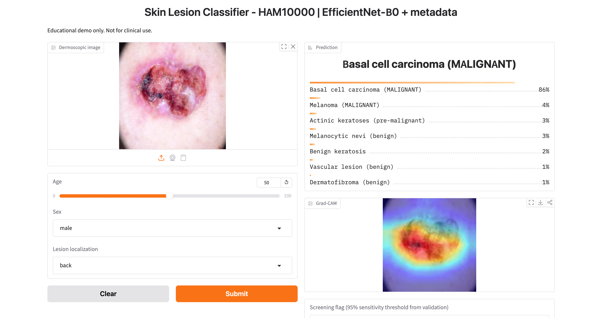
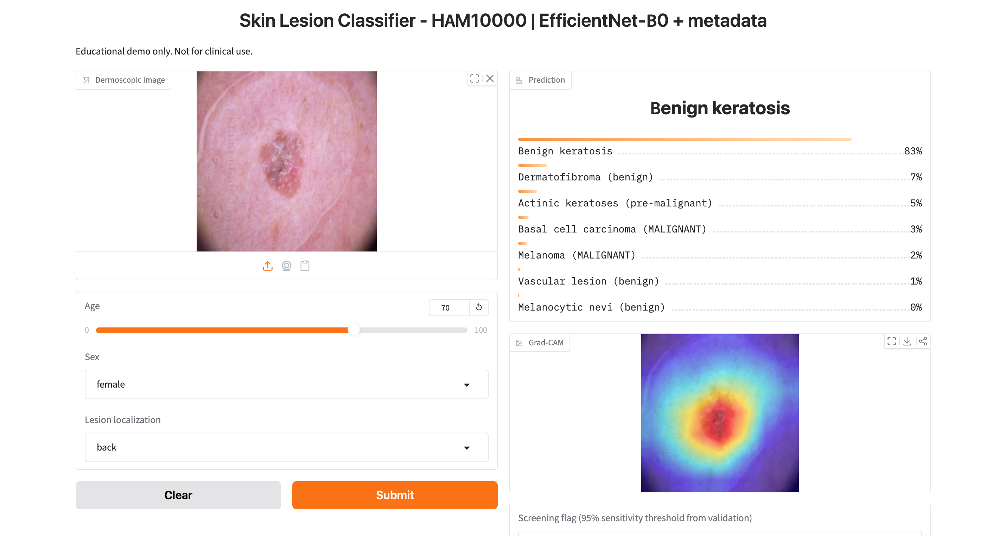
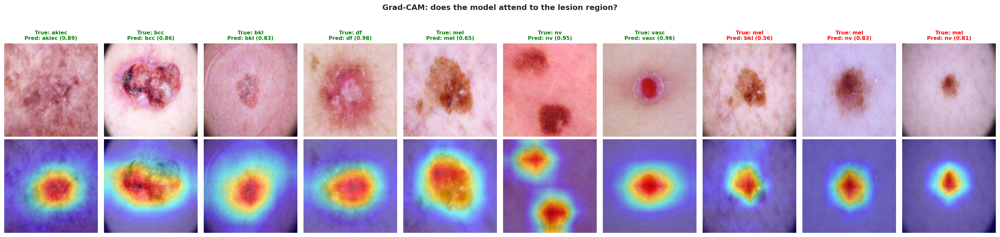
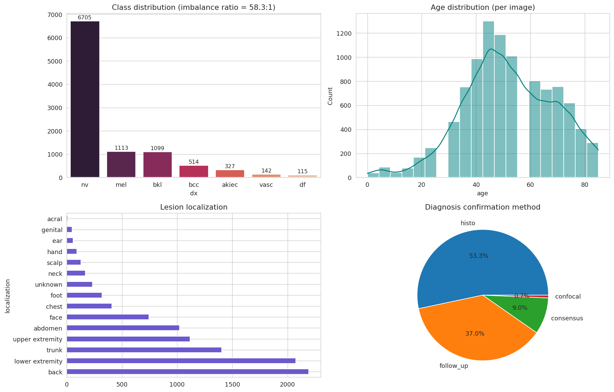
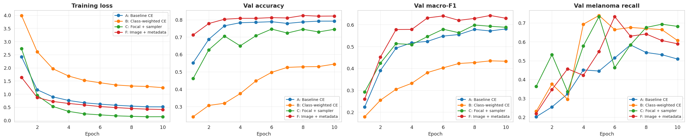
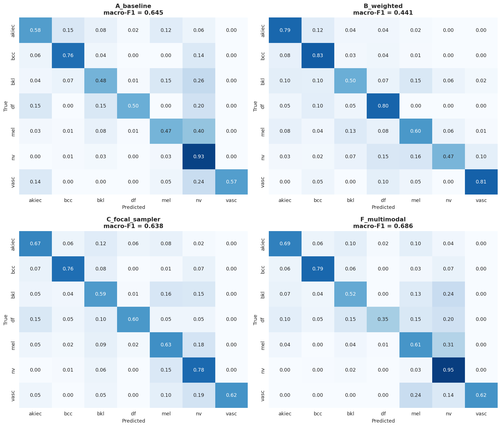
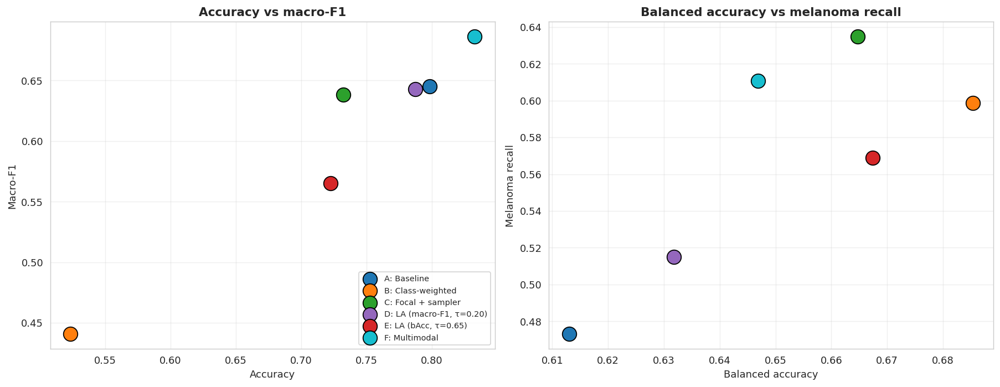
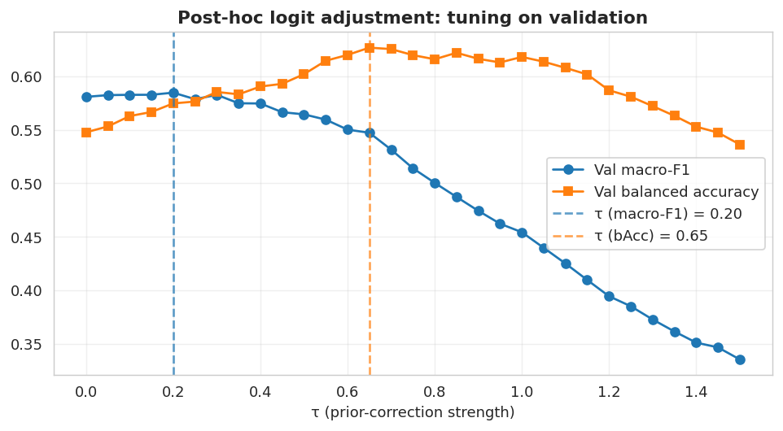
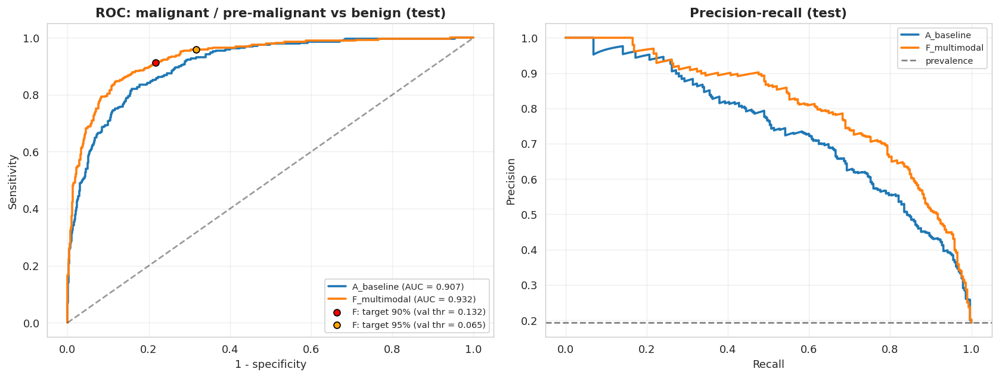

# Skin Lesion Classification on HAM10000: Image + Metadata Fusion

[](https://colab.research.google.com/github/wachirapatsiri/skin-lesion-classification/blob/main/notebooks/HAM10000_skin_lesion.ipynb)

A 7-class dermoscopic skin-lesion classifier built on **EfficientNet-B0**. The project compares several ways of handling severe class imbalance, tests whether adding patient metadata (age, sex, lesion site) improves a pure image model, analyses malignant-vs-benign screening with thresholds chosen on validation data, explains predictions with **Grad-CAM**, and ships a **Gradio demo**.

> **Disclaimer:** educational / coursework project. It is not a medical device and must not be used for clinical decisions.

## Demo

| Malignant example | Benign example |
|---|---|
|  |  |

The Gradio app takes a dermoscopic image plus age, sex and lesion site, and returns class probabilities, a Grad-CAM overlay and a screening flag based on a validation-selected threshold (95% target sensitivity).

## Highlights

- **Data:** HAM10000, 10,015 images, 7,470 unique lesions, 7 classes, imbalance ratio 58.3 : 1 (nv 6,705 vs df 115).
- **Leakage-aware split:** stratified 70/15/15 split **grouped by `lesion_id`** (train 6,981 / val 1,532 / test 1,502 images), with assertions that no lesion appears in two splits.
- **Model selection on validation only:** best epoch by validation macro-F1; logit-adjustment strength and screening thresholds are also tuned on validation, and the test set is used once for reporting.
- **Six experiments (A-F):** baseline, class-weighted loss, focal loss + balanced sampler, two post-hoc logit-adjustment variants, and image + metadata fusion.
- **Best overall model (F, multimodal):** test accuracy **0.833**, macro-F1 **0.686**, melanoma recall **0.611**, malignant-vs-benign ROC-AUC **0.932**.

## Method

**Preprocessing**
- Images resized once to 256x256 and cached on disk (I/O speed-up). Aspect ratio is not preserved; the demo applies the same resize.
- Missing age (57 rows) filled with the training-set median.
- Training augmentation: RandomResizedCrop(224), horizontal and vertical flips, rotation (30°), ColorJitter, RandomErasing. Evaluation: resize + center crop.

**Models**
- **Image-only:** EfficientNet-B0 (timm, ImageNet-pretrained), mixed precision, AdamW + OneCycleLR, 10 epochs, label smoothing 0.05.
- **Multimodal (F):** the same backbone (1,280-d features) concatenated with an MLP over 19 metadata features (standardized age, one-hot sex, one-hot lesion localization), followed by a linear classifier. Everything else matches the baseline, so A vs F isolates the effect of metadata.

**Experiments**

| ID | Description |
|---|---|
| A | Baseline cross-entropy |
| B | Class-weighted cross-entropy (inverse-frequency weights) |
| C | Focal loss (γ = 2) + class-balanced `WeightedRandomSampler` |
| D | A + post-hoc logit adjustment, strength τ tuned on validation for macro-F1 |
| E | A + post-hoc logit adjustment, strength τ tuned on validation for balanced accuracy |
| F | Image + metadata fusion |

Logit adjustment: `prediction = argmax( log p(y|x) - τ · log π(y) )`, where π is the training class prior.

## Results (test set, 1,502 images)

| Model | Accuracy | Macro-F1 | Balanced Acc | Melanoma Recall |
|---|---|---|---|---|
| A. Baseline CE | 0.7983 | 0.6449 | 0.6130 | 0.4731 |
| B. Class-weighted CE | 0.5233 | 0.4407 | **0.6854** | 0.5988 |
| C. Focal loss + balanced sampler | 0.7324 | 0.6383 | 0.6647 | **0.6347** |
| D. A + logit adjustment (macro-F1 tuned) | 0.7876 | 0.6426 | 0.6318 | 0.5150 |
| E. A + logit adjustment (bAcc tuned) | 0.7224 | 0.5651 | 0.6674 | 0.5689 |
| **F. Multimodal (image + metadata)** | **0.8329** | **0.6861** | 0.6469 | 0.6108 |

**Findings**

- **Metadata helps.** Fusion (F) gives the best accuracy and macro-F1 (+0.041 macro-F1, +0.035 accuracy over A) and raises melanoma recall from 0.473 to 0.611 without the large accuracy loss seen in B.
- **Re-weighting trades accuracy for balance.** Class-weighted CE (B) has the highest balanced accuracy but loses about 27 points of accuracy. Focal loss + sampler (C) is a gentler trade-off: macro-F1 close to the baseline, with the highest melanoma recall.
- **Logit adjustment is a tunable dial.** D (macro-F1 tuned) is essentially the baseline on test. E (balanced-accuracy tuned) shifts toward minority classes at a cost in accuracy and macro-F1.
- **Development note:** an earlier version of C that put class weights inside the focal loss *and* used the weighted sampler over-corrected for imbalance and collapsed to 0.386 accuracy. The final C uses the sampler only.

### Per-class report (model F)

| Class | Precision | Recall | F1 | Support |
|---|---|---|---|---|
| akiec | 0.600 | 0.692 | 0.643 | 52 |
| bcc | 0.778 | 0.789 | 0.783 | 71 |
| bkl | 0.702 | 0.521 | 0.598 | 167 |
| df | 0.778 | 0.350 | 0.483 | 20 |
| mel | 0.607 | 0.611 | 0.609 | 167 |
| nv | 0.900 | 0.946 | 0.922 | 1004 |
| vasc | 1.000 | 0.619 | 0.765 | 21 |
| **macro avg** | 0.766 | 0.647 | 0.686 | 1502 |

Melanocytic nevi (the majority class) are classified best; dermatofibroma (`df`, 20 test images) and benign keratosis (`bkl`) are the weakest classes.

### Malignant / pre-malignant vs benign screening

Positive class = `mel + bcc + akiec` (290 test images); risk score = summed probability of those classes. The threshold for each target sensitivity is chosen on the **validation** set, then sensitivity and specificity are measured on the **test** set.

| Model | ROC-AUC | Target sensitivity | Test sensitivity | Test specificity | Missed positives |
|---|---|---|---|---|---|
| A (image-only) | 0.907 | 90% | 0.879 | 0.743 | 35 / 290 |
| A (image-only) | 0.907 | 95% | 0.955 | 0.615 | 13 / 290 |
| **F (multimodal)** | **0.932** | 90% | 0.914 | 0.784 | 25 / 290 |
| **F (multimodal)** | **0.932** | 95% | 0.959 | 0.684 | 12 / 290 |

At the 95% operating point the multimodal model keeps higher specificity than the image-only model (0.684 vs 0.615). Note that validation-selected thresholds do not transfer perfectly: the baseline's "90%" threshold reached 0.879 on the test set.

## Explainability

Grad-CAM on the multimodal model (last convolution of the EfficientNet backbone) for one correctly classified example per class and for missed melanomas:



Heatmaps are a plausibility check, not evidence that the model reasons like a clinician.

## Figures

| | |
|---|---|
|  |  |
|  |  |
|  |  |

## Run it

Developed on Google Colab (Tesla T4, about 1 minute per epoch, roughly 10 minutes per model).

1. Click the **Open in Colab** badge (or upload `notebooks/HAM10000_skin_lesion.ipynb` to Colab) and select a **GPU** runtime.
2. Provide Kaggle API credentials when asked (`kaggle.json`). Never commit them.
3. Run all cells top to bottom. Checkpoints, split CSVs, figures and result tables are saved to Google Drive under `MyDrive/HAM10000_Project`.
4. Set `RETRAIN = False` in the config cell to reuse saved checkpoints after a Colab disconnect.

Main dependencies: PyTorch, torchvision, timm, grad-cam, gradio, scikit-learn, pandas, seaborn, matplotlib, Pillow.

## Repository layout

```
notebooks/   HAM10000_skin_lesion.ipynb
figs/        eda.png, samples.png, curves.png, confusion.png, tau_tuning.png,
             tradeoff.png, roc_screening.png, gradcam.png, demo_*.png
results/     results_final.csv, screening_results.csv, classification_report.csv
```

The dataset images and model checkpoints are not included (dataset license, file size).

## Limitations

- **Single run, single split.** Seeds are fixed, but GPU training is not fully deterministic. In an earlier run of the same pipeline (before seeds were fixed) the baseline and multimodal macro-F1 were 0.656 and 0.702: the multimodal gain had the same direction, but absolute numbers moved by roughly 0.01-0.02, so small differences between models are within noise. Repeating over several seeds or bootstrapping the test set would quantify this.
- **Tiny minority classes in the test set** (`df` = 20, `vasc` = 21 images), so per-class metrics for those classes are very noisy.
- **No patient ID in HAM10000.** The split is at lesion level, so the same patient may appear in more than one split.
- **Limited data source.** Images come from a limited set of clinics and devices; generalization to other populations or cameras is untested.
- **Screening thresholds** are selected on a small validation set and may not transfer exactly to new data.
- **Not clinically validated.**

## Data, license and citation

HAM10000 is distributed under **CC BY-NC-SA 4.0 (non-commercial)**:

> Tschandl P., Rosendahl C., Kittler H. *The HAM10000 dataset, a large collection of multi-source dermatoscopic images of common pigmented skin lesions.* Scientific Data 5, 180161 (2018).

Code in this repository is released under the MIT License (see `LICENSE`).

## Authors

- ([@wachirapatsiri](https://github.com/wachirapatsiri)) - owner
